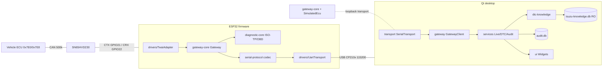
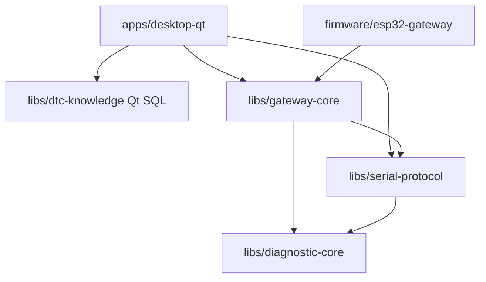
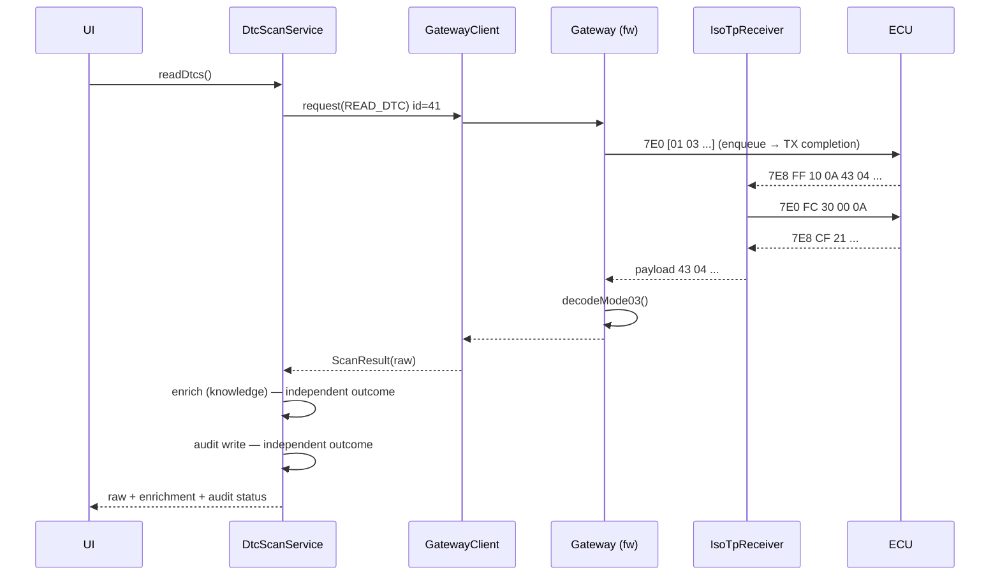

# Architecture

## 1. System overview

The key idea (ADR-003): `gateway-core` is identical in the firmware and in the
desktop's simulation mode. Only the edges differ:

| Edge | Firmware vehicle | Firmware simulation | Desktop simulation / tests |
|---|---|---|---|
| CAN port | `TwaiAdapter` | `SimulatedEcu` | `SimulatedEcu` |
| Byte stream | UART0 | UART0 | in-process loopback |
| Clock | `esp_timer` | `esp_timer` | `QElapsedTimer` / fake clock |

## 2. Library layering

Rules: `diagnostic-core` depends on nothing but the C++17 standard library
(`<cstdint>`, `<array>`, `<cstring>`); no heap, no exceptions, no I/O.

## 3. Modules

| Module | Phase | Guide |
|---|---|---|
| `libs/diagnostic-core` | 1 ✅ | `can-isotp-obd-guide-tr.md` |
| `libs/serial-protocol` | 1 ✅ | `serial-protocol.md` |
| `libs/gateway-core` | 2 ✅ (host) | `firmware-guide-tr.md` |
| `firmware/esp32-gateway` | 2 | `firmware-guide-tr.md` |
| `apps/desktop-qt` | 3 🟡 (skeleton) | `desktop-guide-tr.md` |
| `libs/dtc-knowledge` | 3 ✅ | `dtc-database.md` |

## 4. Mode 03 end-to-end sequence

