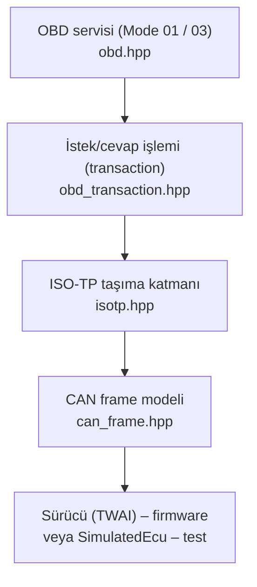
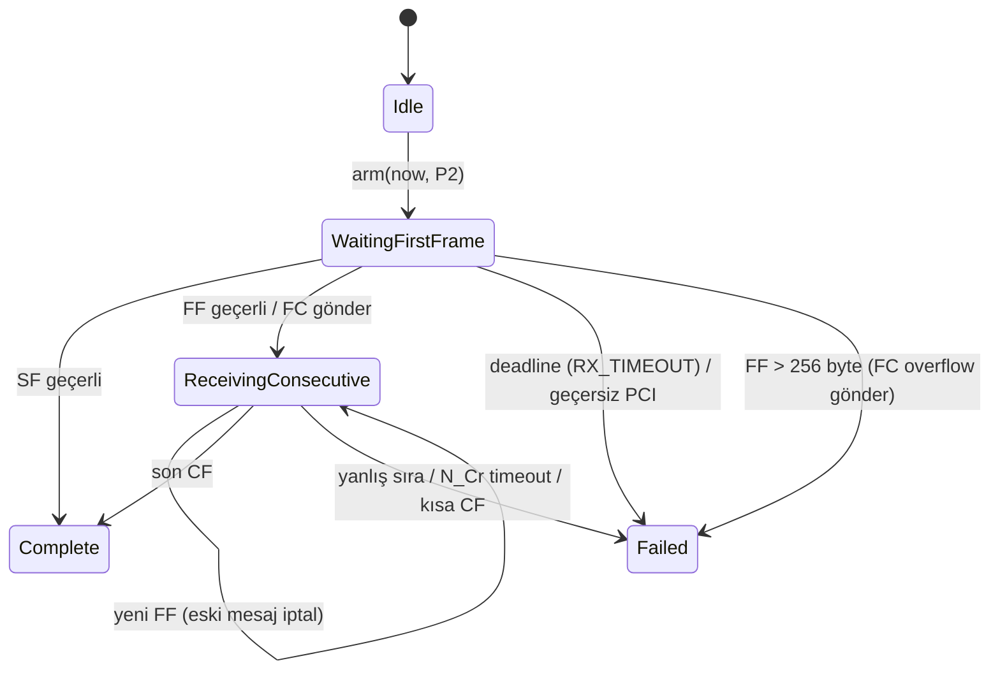

# CAN, ISO-TP ve OBD Öğrenme Rehberi

Bu rehber `libs/diagnostic-core` kütüphanesini okumaya başlamadan önce gereken
temel bilgiyi verir. Kod sembolleri ve Doxygen yorumları İngilizcedir (ADR-010).

**Okuma sırası:** `error.hpp` → `can_frame.hpp` → `dtc.hpp` → `isotp.hpp` →
`obd.hpp` → `obd_transaction.hpp`, her birinden sonra ilgili test dosyası
(`tests/unit/core/test_*.cpp`).

## 1. Katmanlar



Her katman yalnızca altındakini bilir. `diagnostic-core` hiçbir zaman saat okumaz,
frame göndermez veya bloklamaz: zaman parametre olarak gelir, gönderilecek frame
çağırana döndürülür. Böylece aynı kod ESP32'de, masaüstü simülasyonunda ve host
testlerinde birebir aynı çalışır.

## 2. Classical CAN frame

* **Identifier (ID):** 11-bit (standard, `0x000–0x7FF`) veya 29-bit (extended). MVP 11-bit kullanır.
* **DLC (Data Length Code):** 0–8 veri byte'ı.
* **ACK:** Bir frame'i en az bir başka düğüm doğru alırsa ACK biti verir. Hatta başka düğüm
  yoksa (veya transceiver hatta sürmüyorsa) gönderici ACK alamaz, **TEC (Transmit Error
  Counter)** her denemede 8 artar. Eski sistemde görülen "+8" davranışı tam olarak budur.
* CAN ACK, ECU'nun OBD isteğini *anladığını* göstermez; yalnızca frame'in bit düzeyinde
  alındığını gösterir. Bu yüzden `Stage::CanTxCompletion` ile `Stage::RxTimeout` ayrıdır.

## 3. OBD adresleme (ISO 15765-4)

| Amaç | ID |
|---|---|
| Fiziksel istek, ECU #1 (motor) | `0x7E0` |
| ECU #1 cevabı | `0x7E8` (= istek + 8) |
| Diğer ECU cevapları | `0x7E9–0x7EF` |
| Functional (herkese) istek | `0x7DF` (MVP'de yok) |

ISO 15765-4 tanı frame'lerinin DLC=8 olmasını ister; kullanılmayan byte'lar
`IsoTpConfig::padding` ile doldurulur.

## 4. ISO-TP (ISO 15765-2)

8 byte'tan büyük cevaplar (ör. çok DTC'li Mode 03) parçalara bölünür. İlk byte
**PCI (Protocol Control Information)**'dır:

| Tür | PCI | Anlam |
|---|---|---|
| Single Frame (SF) | `0L` | L = 1..7 byte veri |
| First Frame (FF) | `1L LL` | 12-bit toplam uzunluk, 6 byte veri |
| Consecutive Frame (CF) | `2N` | N = sıra numarası, 7 byte veri |
| Flow Control (FC) | `3S BS ST` | S: 0 devam, 1 bekle, 2 taşma |

Örnek — 4 DTC'li Mode 03 cevabı (10 byte):

```text
ECU → 7E8  10 0A 43 04 01 0A 04 01   FF: toplam 0x0A=10 byte, ilk 6 byte
Biz → 7E0  30 00 00 00 00 00 00 00   FC: devam et, BS=0 (hepsini gönder), STmin=0
ECU → 7E8  21 03 FF C1 23 00 00 00   CF #1: kalan 4 byte (+ dolgu)
```

### Durum makinesi



Önemli kurallar ve nedenleri:

* **Mutlak deadline:** Her frame'den sonra "yeniden 500 ms bekle" yaparsak, sürekli alakasız
  frame gelen bir hatta sonsuza kadar bekleyebiliriz. Deadline `arm()` anında sabitlenir.
* **Stale frame:** İstekten *önce* kuyruğa girmiş bir cevap, eski bir isteğe aittir;
  `timestampUs < armedAt` ise yok sayılır (`staleFrames` sayacı).
* **Sıra numarası 15'ten sonra 0'a döner** (1'e değil). `isotp_sequence_number_wraps_from_15_to_0` testi.
* **Yanlış sıra = iptal.** ISO-TP'de yeniden gönderim yoktur; eksik parça veriyi bozar.
* **Taşma:** 256 byte'tan büyük FF gelirse ECU'ya FC Overflow gönderilir ki hattı boş yere doldurmasın.

## 5. OBD servisleri (SAE J1979)

Pozitif cevap = servis + `0x40`. Negatif cevap = `7F <servis> <NRC>`.

### Mode 01 PID formülleri

| PID | Ad | Formül | Birim |
|---|---|---|---|
| `0x04` | Calculated engine load | `A × 100 / 255` | % |
| `0x05` | Coolant temperature | `A − 40` | °C |
| `0x0C` | Engine RPM | `(256A + B) / 4` | rpm |
| `0x0D` | Vehicle speed | `A` | km/h |
| `0x42` | Control module voltage | `(256A + B) / 1000` | V |

Örnek: `41 0C 1A F8` → `(26×256 + 248)/4 = 1726 rpm`.

> Not: Eski sistem `0x42` değerini "BATTERY_VOLTAGE" olarak gösteriyordu; aslında ECU'nun
> beslemesini (control module voltage) ölçer. Yeni adı `MODULE_VOLTAGE`.

### Mode 03 — kayıtlı DTC'ler

CAN üzerinde cevap `43 NN (A B)×NN` şeklindedir; `NN` DTC sayısıdır (K-line'da bu
byte yoktur — eski sistemin bir aşamada yaptığı hata). DTC iki byte'tan şöyle çözülür:

```text
A = 0000 0001  B = 0000 1010
    ││└┴──── 2. hane = 1
    ││
    └┴────── sistem 00 = P, 1. hane = 0      → P 0 1 0 A = "P010A"
```

### NRC (Negative Response Code)

| NRC | Ad | Davranış |
|---|---|---|
| `0x78` | responsePending | ECU'nun ek zamana ihtiyacı var: P2* (5 s) kadar bekle, en fazla 8 kez |
| `0x22` | conditionsNotCorrect | Hata olarak raporla, detail = `0x22` |
| `0x11` / `0x12` / `0x31` | desteklenmiyor / aralık dışı | "unsupported" olarak gösterilebilir |

## 6. Yapılandırılmış hata (structured error)

Her hata `{stage, code, detail}` taşır. Örnekler:

| Durum | stage | code | detail |
|---|---|---|---|
| Sürücü kuyruğu dolu | `CAN_ENQUEUE` | `QUEUE_FULL` | — |
| ACK yok | `CAN_TX` | `TX_FAILED` | — |
| TX tamamlanma bildirimi hiç gelmedi | `CAN_TX` | `TIMEOUT` | — |
| ECU sessiz | `RX_TIMEOUT` | `TIMEOUT` | alınan byte sayısı |
| CF sırası 2 beklenirken 3 geldi | `ISOTP` | `BAD_SEQUENCE` | `0x0203` |
| ECU "koşullar uygun değil" dedi | `NRC` | `NEGATIVE_RESPONSE` | `0x22` |
| Uzunluk tutmuyor | `OBD_DECODE` | `MALFORMED_PAYLOAD` | uzunluk |

Bu sayede masaüstü "Scan failed" yerine hatanın hangi katmanda oluştuğunu gösterebilir.

## 7. Mode 04 neden kapalı?

Mode 04 DTC'leri, freeze-frame verisini ve readiness monitor'leri siler. Gerçek araçta
geri alınamaz ve muayene/emisyon durumunu etkiler. Kod yalnızca `DIAG_ENABLE_MODE04=1`
ile derlenir; kütüphane bu tanım olmadan derlenir. Simülasyon testi tek bir çeviri
biriminde (`test_mode04_simulation_only.cpp`) codec'i doğrular. Ayrıntı: ADR-008.

## 8. Kendin dene

1. `tests/unit/core/test_isotp.cpp` içindeki çok-frame testinde CF sıra numarasını `0x22`
   yap; hangi testin, hangi `detail` ile başarısız olacağını **önce tahmin et**, sonra çalıştır:
   `build/host-debug/tests/core_tests.exe isotp`
2. `0x7F 0x01 0x12` cevabı için `ObdTransaction` hangi `Error`'ı üretir? Testini yaz.
