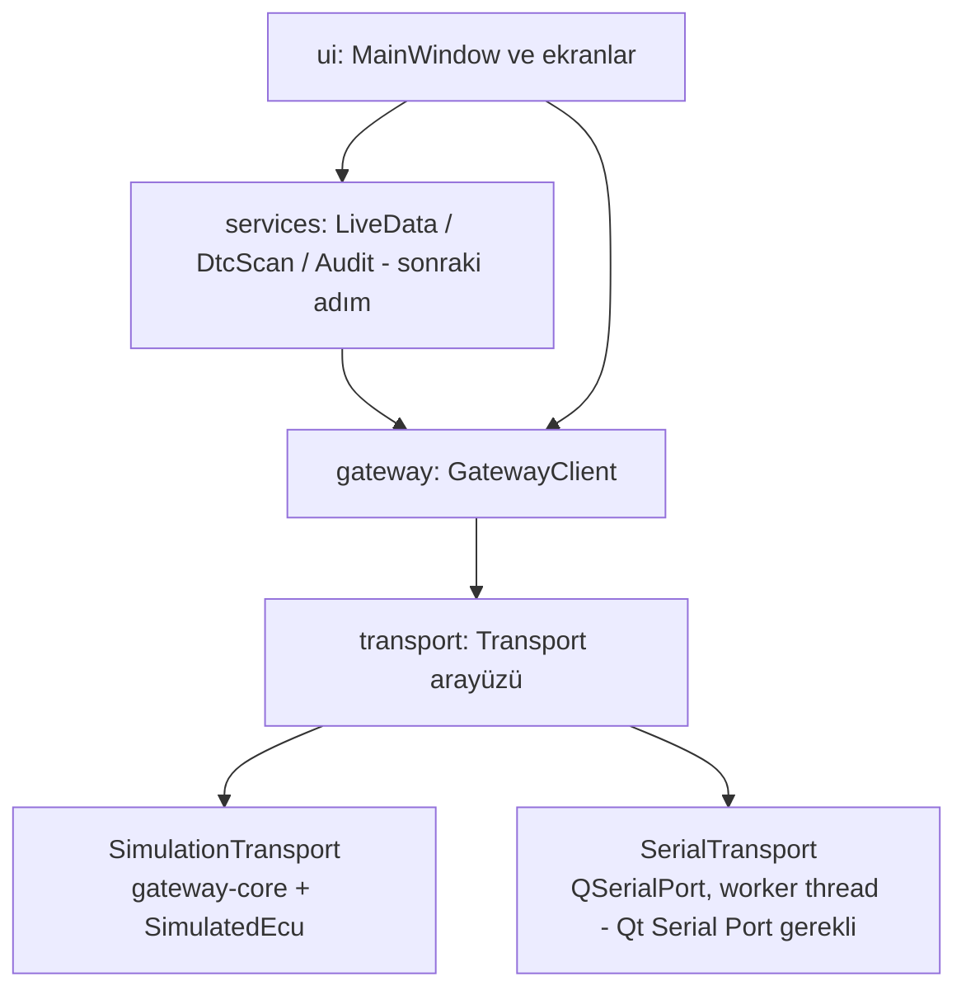

# Masaüstü Rehberi (Qt 6 Widgets)

> Durum (2026-11-08): Simülasyon ve seri port transport'ları, `GatewayClient` ve basit bir ana
> pencere (port seçimi dahil) çalışıyor. Seri transport donanımsız testlerden geçti, ancak gerçek
> ESP32 ile **henüz denenmedi**. DTC bilgi veritabanı, audit ve ekranlar sonraki adımlarda.

**Okuma sırası:** `src/transport/transport.hpp` → `src/transport/simulation_transport.*` →
`src/gateway/gateway_types.hpp` → `src/gateway/gateway_client.*` →
`tests/unit/desktop/test_gateway_client.cpp` → `src/ui/main_window.*`.

## 1. Katmanlar



`desktop_core` statik kütüphanesi widget içermez. Bu sayede client ve servisler GUI olmadan
(`QTEST_GUILESS_MAIN`) test edilebilir.

## 2. Transport sözleşmesi

* Sinyaller **asenkron** gelir, hiçbir zaman `write()` çağrısının içinden gelmez. Gerçek seri
  port böyle davranır; simülasyon da 2 ms'lik bir timer ile aynı davranışı taklit eder.
* `closed()` her açılışta tam bir kez gelir (kullanıcı kapatması, USB çıkarma vb.).
* Bloklayan sürücü çağrıları GUI thread'inde çalışmaz. Eski sistemde CP210x çıkarıldığında
  `SerialPort.Close` UI'ı donduruyordu (`70ba8cc`); seri transport bu yüzden worker thread'de
  çalışacak.

## 3. SimulationTransport

Firmware'deki **aynı** `gw::Gateway` ve `gw::SimulatedEcu` kodunu process içinde çalıştırır.
Masaüstü kaynağın SIMULATION olduğunu transport sınıfından *tahmin etmez*. Gateway'in HELLO
cevabındaki `source=SIMULATION` alanına bakar (brief §13).

Hata enjeksiyonu: `setLinkMuted()` (ölü hat), `injectToDesktop()` (gürültü / sahte frame),
`simulateUnplug()` (USB çıkarma), `setScenario()` (ECU davranışı).

## 4. GatewayClient

| Görev | Nasıl |
|---|---|
| Handshake | `connectToGateway()` → `HELLO`. Protokol sürümü 1 olmalı ve kaynak SIMULATION/VEHICLE olmalı; aksi halde bağlantı kurulmaz (fail closed) |
| Korelasyon | Her bağlantıda rastgele başlangıç id'si; cevap yalnızca id ile eşleşir |
| Zaman aşımı | Her istek için deadline; süre dolunca `SERIAL/TIMEOUT` cevabı üretilir |
| Bağlantı kopması | Bekleyen tüm istekler `SERIAL/DISCONNECTED` ile sonlanır, `connectionLost()` |
| Keep-alive | Hazır durumdayken 1,5 s'de bir `PING`; 2 kayıp PING → bağlantı kapatılır |
| Gateway reboot | `EVT BOOT` gelirse istekler iptal edilir, HELLO tekrarlanır, kaynak değiştiyse bağlantı reddedilir |
| Uzun DTC listesi | `DTC_PART` olayları birleştirilir; `count` tutmazsa `PROTOCOL/MALFORMED_PAYLOAD` (sessizce kırpılmış liste gösterilmez) |

## 5. Neden her şey sinyal?

`send()` bir id döndürür; sonuç her zaman `replyReceived(reply)` sinyaliyle gelir. Bağlantı
yokken bile sonuç *sonraki event loop turunda* gelir. Böylece çağıran kod `send()`
döndükten sonra bağlanabilir ve iki farklı yol (senkron/asenkron) yazmak zorunda kalmaz.

## 6. Build ve test

```powershell
$env:QT_ROOT = "C:\Qt\6.11.1\mingw_64"
$env:PATH = "$env:QT_ROOT\bin;C:\Qt\Tools\mingw1310_64\bin;C:\Qt\Tools\Ninja;$env:PATH"
cmake --preset windows-debug
cmake --build --preset windows-debug
ctest --preset windows-debug
```

Uygulama: `build\windows-debug\apps\desktop-qt\isuzu_diagnostic.exe`.

## 7. Kendin dene

1. `GatewayClient::nextId()` neden her bağlantıda rastgele bir değerden başlıyor? Bir önceki
   bağlantıdan gecikmeli gelen `RES|5|OK|...` cevabını düşün.
2. `silentLinkTimesOutOnDesktopSide` testinde `setLinkMuted(true)` yerine `Silent` senaryosu
   kullanılsaydı hangi hata aşaması (stage) dönerdi? Neden?
