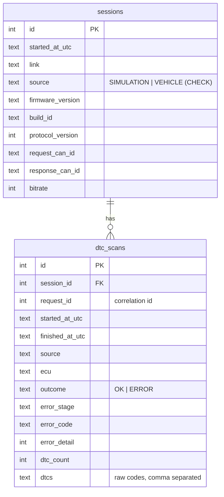

# DTC Knowledge and Audit Databases

Two separate SQLite files (ADR-007):

| | Knowledge DB | Audit DB |
|---|---|---|
| File | `data/knowledge/isuzu-knowledge.db` (repo) → copied to `<exe dir>/data/` at build | `%LOCALAPPDATA%/IsuzuDiagnostic/Isuzu Diagnostic System/audit.db` |
| Access | **read-only** (`QSQLITE_OPEN_READONLY`) | read-write |
| Code | `libs/dtc-knowledge` (`KnowledgeRepository`) | `apps/desktop-qt/src/data/audit_store.*` (`AuditStore`) |
| Versioning | `kb_metadata.schema_version` must be `1` | `PRAGMA user_version` = number of applied migrations |
| Error stage | `DATABASE` | `AUDIT` |

## 1. Knowledge DB

* Origin: reference repository `Data/knowledge-base/isuzu-knowledge.db` (dataset `v2`, generated
  2026-09-13 from 13 Isuzu service documents). Imported unchanged.
* SHA-256: `e07c21259e8afb5bf5da413db46d2db85e802292db04bdefd3331f3135669811` – the unit test
  `knowledgeOpensRealDatabaseReadOnly` checks that lookups leave the file byte-identical.
* Content: 317 DTCs, 541 profiles (per application/engine), causes, OEM diagnosis/confirmation
  steps, solutions, DTC ↔ live-parameter links, 7 applications (4HK1, 6HK1, 4JZ1 variants).

### Lookup rules (`KnowledgeRepository::lookup`)

1. The code is normalised (`p0087 ` → `P0087`) and validated with `diag::Dtc::fromText`.
   Invalid → `DATABASE/INVALID_ARGUMENT`.
2. Not in `dtc_codes` → **`Unknown`** (normal result, shown as "Unknown DTC").
3. Found → title and system from `dtc_codes`; one *best profile* supplies description and
   procedure steps: matching application first, then most OEM steps, then has description,
   then most causes.
4. Causes and solutions are collected across all applicable profiles (one manual may have the
   procedure, another the cause table), de-duplicated; if the selected application has none, the
   generic set is used – known knowledge is never hidden.
5. Related live data: generic links plus links of the selected application.

### Validation at open

| Problem | Result |
|---|---|
| File missing | `DATABASE/NOT_FOUND` |
| Not a SQLite file | `DATABASE/STORAGE_FAILURE` |
| Required table missing | `DATABASE/INVALID_STATE` (detail = table index) |
| `schema_version` ≠ 1 | `DATABASE/INVALID_STATE` (detail = version) |

## 2. Audit DB (schema v1)

* Only **raw** acquisition data is stored. Knowledge enrichment is recomputed when displayed.
* Failed scans are stored too (stage/code/detail) – they are diagnostic evidence.
* Migrations are C++ string constants in `audit_store.cpp`; never edit a shipped migration, append.
  Each runs in a transaction; a file with a higher `user_version` is refused (`AUDIT/INVALID_STATE`).
* Qt binds a null `QString` as SQL `NULL`; text values are normalised to `''` before binding
  (found by tests: empty DTC list and missing ECU id were rejected by `NOT NULL`).

## 3. Outcome separation in the scan service

`DtcScanService` reports **acquisition**, per-code **enrichment** (`Known` / `Unknown` /
`KnowledgeUnavailable`) and **audit** independently. Tests prove: missing knowledge DB keeps all raw
codes; a real audit write failure (table dropped underneath) leaves a successful, enriched scan intact;
a negative ECU response is audited with stage `NRC` and detail `22`.
