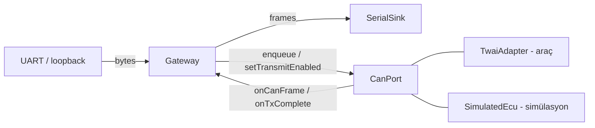
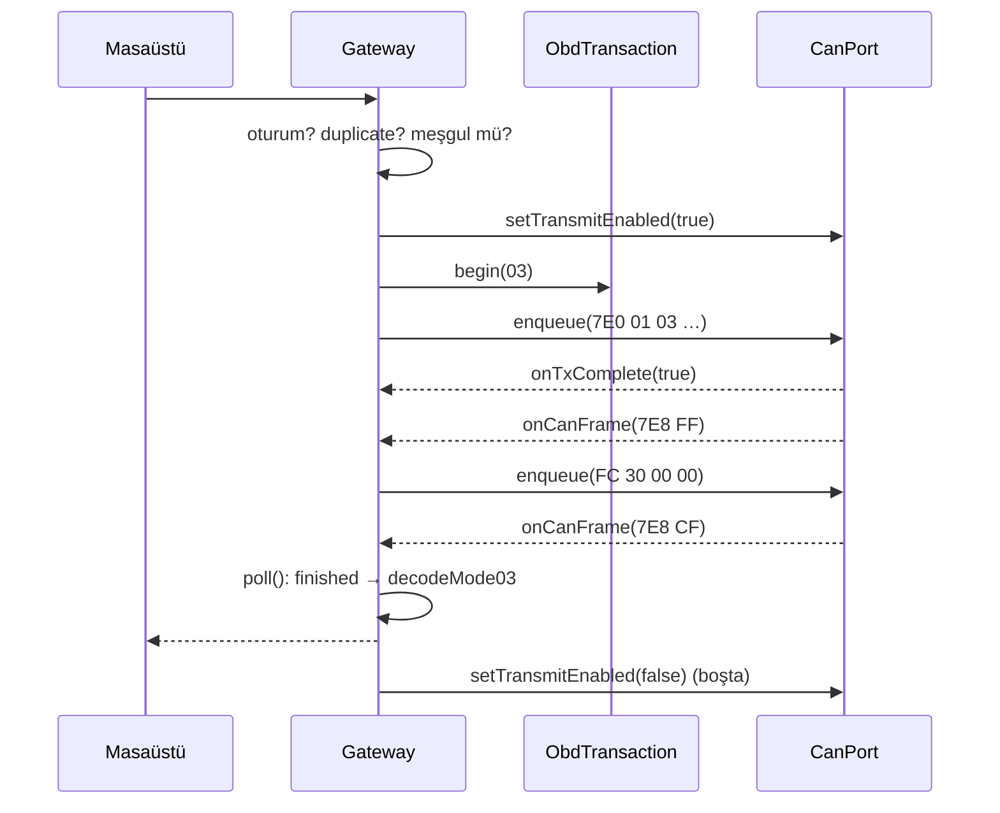

# Firmware Rehberi (gateway-core + ESP32)

> Durum: `libs/gateway-core` tamamlandı ve host üzerinde test edildi. ESP-IDF projesi
> (`firmware/esp32-gateway`, TWAI adapter, UART) bir sonraki aşamada yazılacak; bu bölüm o
> zaman genişletilecek.

**Okuma sırası:** `gw/ports.hpp` → `gw/gateway.hpp` → `src/gateway.cpp` →
`gw/simulated_ecu.hpp` → `tests/unit/gateway/test_gateway.cpp`.

## 1. Neden ayrı bir `gateway-core`?

Eski firmware'de komut işleme, OBD ve TWAI çağrıları `esp32_gateway.c` içinde iç içeydi.
Bu yüzden ancak gerçek kartta ve link-time mock'larla test edilebiliyordu. Yeni tasarımda
gateway mantığı saf C++ ve dış dünyayla yalnızca üç arayüzle (port) konuşuyor:

Aynı `Gateway` sınıfı şu üç yerde çalışır: ESP32 araç profili (TWAI), ESP32 simülasyon
profili (SimulatedEcu, transceiver gerekmez) ve masaüstü simülasyonu/testler.

## 2. Tek görev (single task) kuralı

`Gateway`'in hiçbir metodu kilit (mutex) kullanmaz. Bunun yerine **tüm çağrılar tek bir
FreeRTOS görevinden** yapılır:

* TWAI ISR yalnızca frame'i bir kuyruğa koyar ve sayaç artırır (ISR'da log veya allocation yok).
* Uygulama görevi kuyruğu boşaltır, `onCanFrame()` / `onTxComplete()` çağırır, UART'tan
  okuduğu byte'ları `onSerialBytes()`'a verir ve her 1–10 ms'de `poll()` çağırır.

Bu sayede yarış durumu (race condition) mümkün olmaz ve kod host üzerinde birebir test edilir.

## 3. Güvenlik davranışları (ADR-008, ADR-009)

| Kural | Neden | Test |
|---|---|---|
| Açılışta listen-only | Masaüstü bir şey istemeden hatta tek bit bile göndermemek | `gateway_boots_listen_only_and_announces_source` |
| `HELLO` olmadan CAN isteği yok | Kaynak (SIMULATION/VEHICLE) doğrulanmadan işlem yapılmaz | `gateway_rejects_can_commands_before_hello` |
| 5 s sessizlikte oturum biter | Masaüstü çökerse veya USB çıkarılırsa ECU sorgulanmaya devam etmez | `gateway_session_timeout_stops_live_and_disables_tx` |
| Art arda 3 zaman aşımı → canlı veri durur | Eski sistemde cevapsız TX'ler TEC'i +8 artırıyordu | `gateway_live_backs_off_on_silent_bus` |
| Aynı request id tekrar CAN'e gitmez | Seri hattaki tekrar, araçta tekrar işlem demek olmamalı | `gateway_duplicate_request_id_is_not_retransmitted` |
| Otomatik retry yok | Gerçek hatayı gizler, yan etkiyi tekrarlar | `transaction_is_single_outstanding_and_never_retries` |
| `CLEAR_DTC` → `CAPABILITY/DISABLED` | Mode 04 gerçek araçta geri alınamaz | `gateway_mode04_is_disabled` |

## 4. İstek yaşam döngüsü

## 5. SimulatedEcu senaryoları

`EcuScenario` değerleri: `NORMAL`, `NO_DTCS`, `SINGLE_DTC`, `MANY_DTCS` (40 kod, parçalı
cevap), `UNKNOWN_DTC` (P3FFF), `SILENT`, `NEGATIVE_RESPONSE` (NRC 0x22),
`RESPONSE_PENDING` (0x78 sonra cevap), `MALFORMED_DTC`, `BAD_SEQUENCE`, `NO_ACK`
(TEC +8), `UNSUPPORTED_VOLTAGE` (PID 0x42 → NRC 0x31).

Simülatör frame seviyesinde cevap verir: çok-frame cevapta önce FF gönderir, **FC
gelmeden CF göndermez**. Böylece gateway'in ISO-TP kodu gerçekten çalışır. Canlı
değerler zamanın deterministik fonksiyonudur (ör. RPM 20 s'de 750↔2500 üçgen dalga).

> SIMULATION — NO VEHICLE DATA: Simülatörün ürettiği hiçbir değer gerçek araç verisi değildir.
> HELLO cevabındaki `source=SIMULATION` bunu masaüstüne bildirir.

## 6. Kendin dene

1. `SimulatedEcu::sendConsecutiveFrames` içinde `BadSequence` senaryosunun başlangıç
   sırasını 2 yerine 0 yap. `gateway_reports_malformed_and_bad_sequence_dtc_responses`
   testi hangi `detail` ile başarısız olur? Önce tahmin et.
2. `GatewayConfig::sessionTimeoutMs` neden canlı veri periyodundan (≥ 500 ms) çok daha
   büyük olmalı? Masaüstünün PING aralığı ile ilişkisini açıkla.
